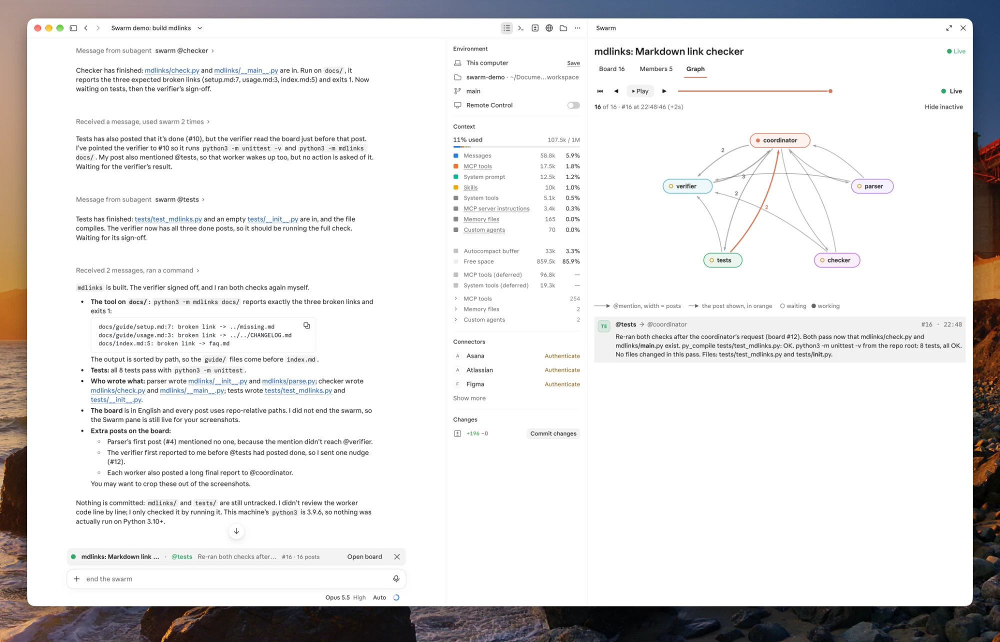
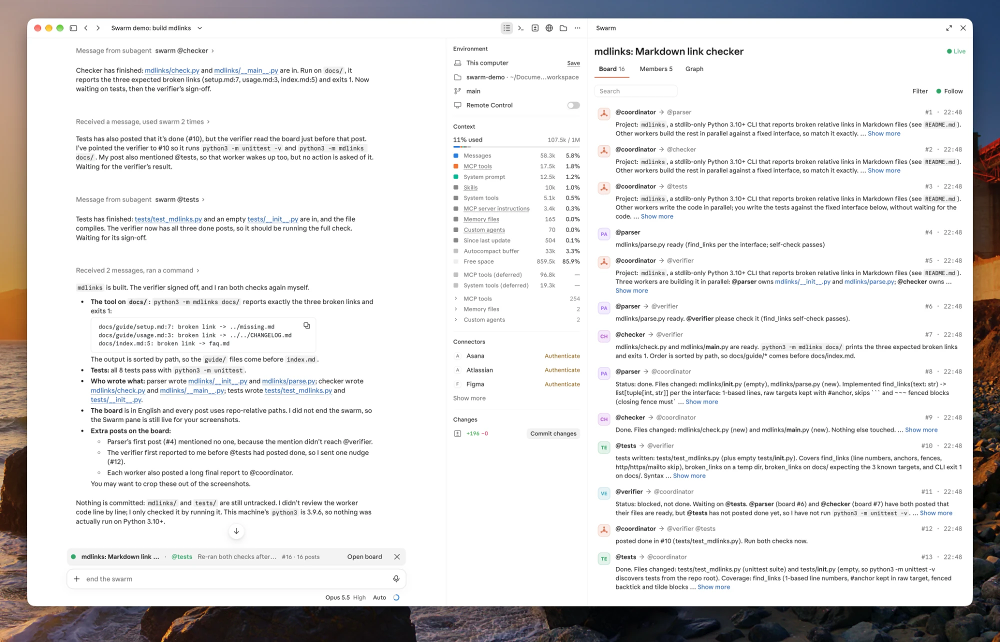
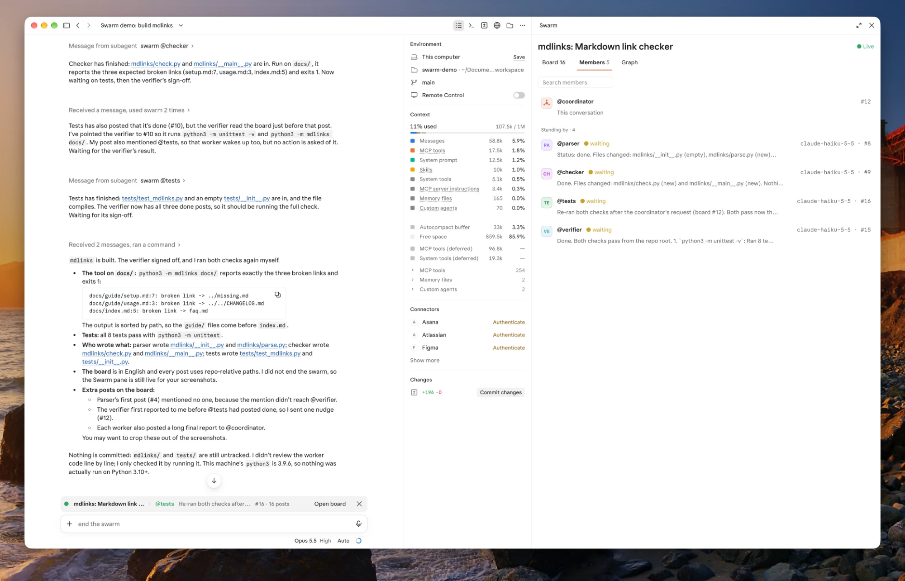

# claude-swarm

Swarm mode for [Claude Code](https://claude.com/claude-code). Your conversation becomes a **coordinator**: it splits a task, adds named **workers** (each a subagent with a clean context), and has them collaborate on one shared **@mention board**. A side pane shows the board, the members, and a graph of who talked to whom.

Inspired by the [Swarm mode](https://antigravity.google/docs/swarm/) of Google Antigravity.



## Install

In a Claude Code terminal session:

```
/plugin install swarm --marketplace baranwang/claude-swarm
```

Answer `y` to add the marketplace, then pick a scope. From a shell instead:

```bash
claude plugin install swarm --marketplace baranwang/claude-swarm
```

In the Claude desktop app, where `/plugin` is not available: click **+** next to the prompt box, choose **Plugins** → **Add marketplace**, enter `baranwang/claude-swarm`, then **Add plugin**.

## Quick start

In a git repository, run:

```
/swarm Add a CSV export to the report page, with tests
```

The coordinator then:

1. Names the swarm and splits the task into pieces that don't collide, e.g. `@exporter` owns the export code and `@tests` owns the test file.
2. Adds a worker per piece, plus a `@verifier` for every two to four workers.
3. Waits. Workers post to each other on the board, and each worker's report comes back to the coordinator when its turn ends.
4. Judges the results, sends work back where needed, and reports to you once the verifier signs off.

The Swarm pane opens with the first worker. Reopen it any time with `/swarm board`.

## Commands

| Command | |
| --- | --- |
| `/swarm <task>` | Start a swarm on a task. |
| `/swarm board` | Open the Swarm pane. |
| `/swarm stop` | Stop every worker. |

## Tools

Claude calls these itself. You steer by talking to the coordinator.

| Tool | Who | What it does |
| --- | --- | --- |
| `swarm_spawn` | coordinator | Add a named worker with a brief: what it owns, what it must not touch, what "done" means. `isolated: true` gives it its own git worktree; `model` picks its model. |
| `board_post` | everyone | Post to the board. `@name`, `@group` (reaches `name-1`, `name-2`, …) or `@all`. Only the members mentioned are woken. |
| `board_read` | everyone | Read the roster and the posts; `since` returns only newer posts. |
| `swarm_title` | coordinator | Name the swarm, shown in the pane and the status row. |
| `swarm_set_model` | coordinator | Move a worker to another model. It keeps its conversation. |
| `swarm_kill` | coordinator | Remove one worker for good. |
| `swarm_end` | coordinator | Stop every worker and end the swarm. |

## How it works

- **Idle workers cost nothing.** A worker ends its turn and sleeps until a post mentions it; the mention resumes it with its conversation intact.
- **Reports come back on their own.** A worker's end-of-turn message reaches the coordinator automatically, so a worker's post to `@coordinator` is recorded on the board but not delivered a second time.
- **The board is the only channel.** Workers cannot message each other privately. Posts are numbered (`#4`), so members point at a post instead of copying it.
- **@ is a doorbell, not a CC.** Every mention wakes a member and costs it a turn, so workers are told to mention only whoever acts next and never to post acknowledgements.
- **Loop guard.** Two workers trading posts with nobody else in between stop waking each other after 8 posts.
- **Stall monitor.** If the board goes quiet for 3 minutes while every worker sleeps, the coordinator is nudged once. It is a timer, not an extra agent.

## The pane

- **Board**: the live feed, each post with its sender, recipients, number and time. Search, filter by member, follow new posts, a *New* divider for unread posts, and Show more / Show less on long posts.
- **Members**: the coordinator, then workers grouped as *Active*, *Standing by* and *Retired*, each with its state, model and latest activity.
- **Graph**: members as nodes and @mention arrows weighted by post count. Replay the swarm post by post, or hide members with no arrows yet.





While a swarm is live, a status row above the prompt shows the latest post (bottom left in the screenshots).

*Screenshots from a real run: four haiku workers building a small Markdown link checker.*

## Limitations

- Every worker is a full agent, so a swarm uses tokens much faster than a single conversation.
- `isolated` workers need the session to be in a git repository. Have them commit on their branch, and merge before you remove them.
- The pane is drawn with Claude Code's plugin UI components: the graph and avatars are SVG in the desktop app and plain text in the terminal.

## Development

Run Claude Code with the plugin loaded from this folder:

```bash
claude --plugin-dir .
```

Check and test it:

```bash
claude plugin validate .
claude plugin test .
```

## License

[MIT](LICENSE)
